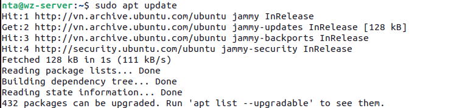
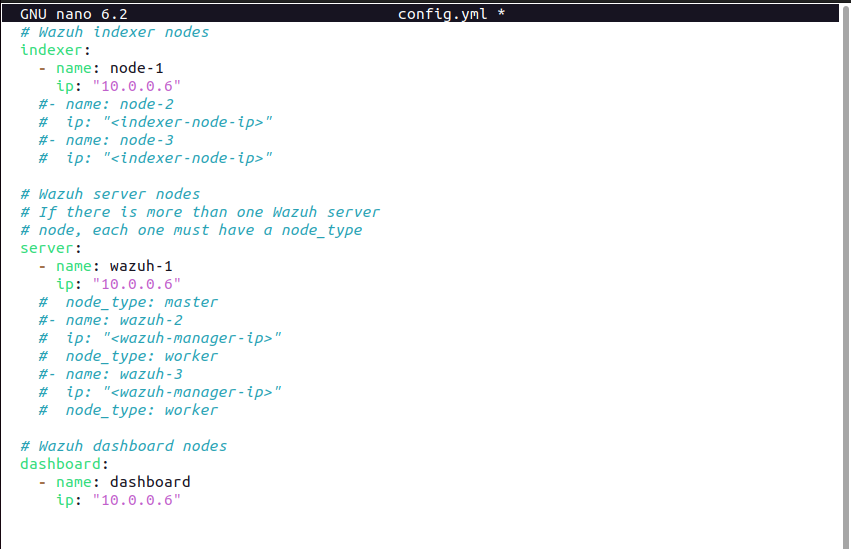
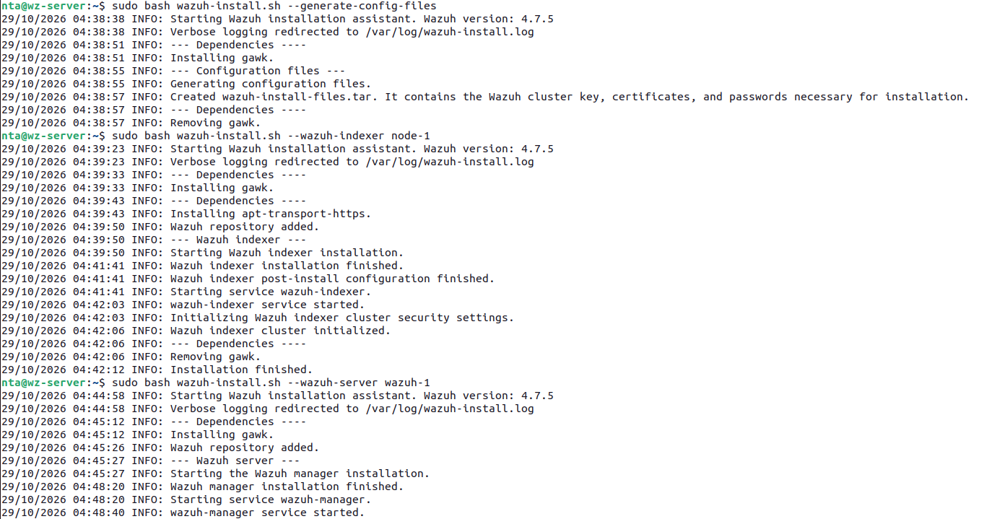
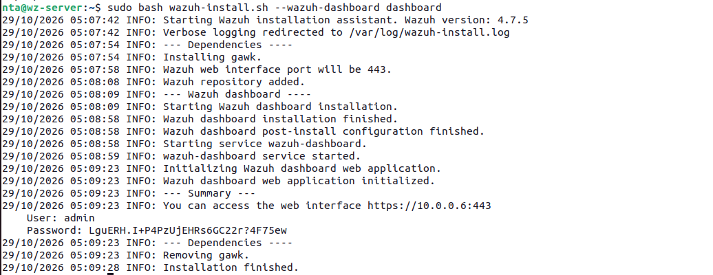
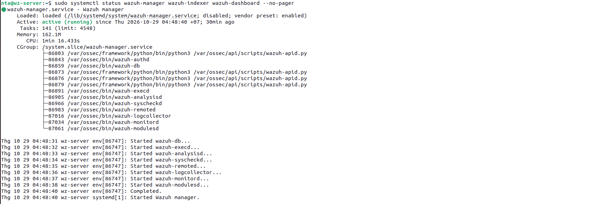
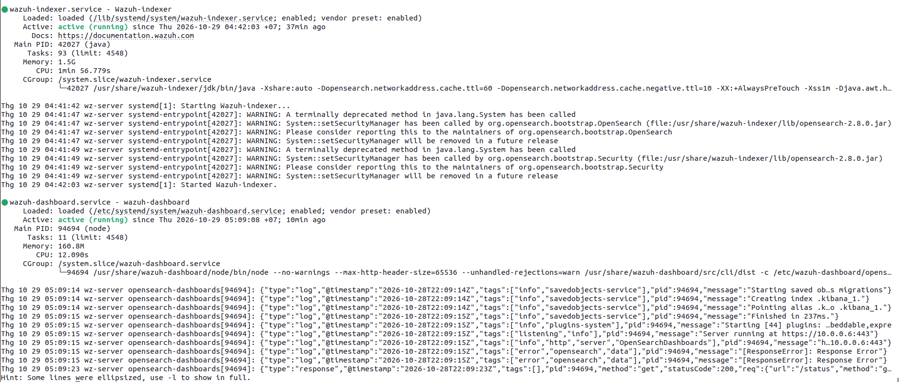
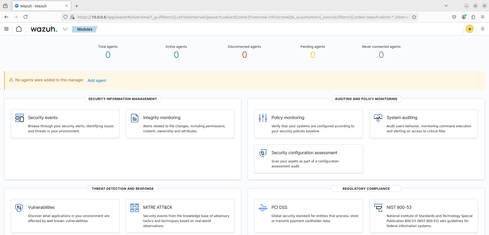

# Phase 1: Infrastructure setup

## Overview

Deploy the Wazuh server in an all-in-one configuration, then prepare the lab virtual machines.

## 1.1 VM specifications

| VM            | OS               | IP       | RAM | CPU    | Disk |
| ------------- | ---------------- | -------- | --- | ------ | ---- |
| Wazuh Server  | Ubuntu 22.04 LTS | 10.0.0.6 | 4GB | 2 core | 50GB |
| Windows Agent | Windows 10       | 10.0.0.7 | 4GB | 2 core | 50GB |
| Linux Agent   | Ubuntu 20.04     | 10.0.0.4 | 2GB | 2 core | 30GB |
| Kali Attacker | Kali Linux       | 10.0.0.5 | 4GB | 2 core | 40GB |

Network: Create a single NAT Network `10.0.0.0/24` and attach all VMs to it. Verify connectivity:

## 1.2 Install Wazuh server (all-in-one)

> Run on: Ubuntu 22.04 - 10.0.0.6

### Step 1 - System update

```bash
sudo apt update && sudo apt upgrade -y
```



### Step 2 - Download installation files

```bash
curl -sO https://packages.wazuh.com/4.7/wazuh-install.sh
curl -sO https://packages.wazuh.com/4.7/config.yml
```

### Step 3 - Edit config.yml

```yaml
nodes:
  indexer:
    - name: node-1
      ip: "10.0.0.6"
  server:
    - name: wazuh-1
      ip: "10.0.0.6"
  dashboard:
    - name: dashboard
      ip: "10.0.0.6"
```



### Step 4 - Run installation

```bash
# Generate certificates
sudo bash wazuh-install.sh --generate-config-files

# Install Wazuh Indexer (Elasticsearch)
sudo bash wazuh-install.sh --wazuh-indexer node-1

# Install Wazuh Manager
sudo bash wazuh-install.sh --wazuh-server wazuh-1

# Install Wazuh Dashboard (Kibana)
sudo bash wazuh-install.sh --wazuh-dashboard dashboard
```




### Step 5 - Retrieve admin password

```bash
sudo tar -O -xvf wazuh-install-files.tar | grep -P "\'admin\'" -A 1
```

> Save this password. You will need it to log in to the dashboard.

## 1.3 Verify installation

```bash
# Check all services are running
sudo systemctl status wazuh-manager
sudo systemctl status wazuh-indexer
sudo systemctl status wazuh-dashboard
```




## 1.4 Access Dashboard

Open a browser and navigate to:

```
https://10.0.0.6
Username: admin
Password: <your-admin-password>
```



> Accept the SSL warning for the self-signed certificate.
