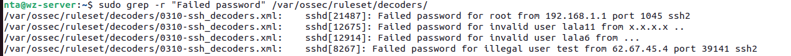
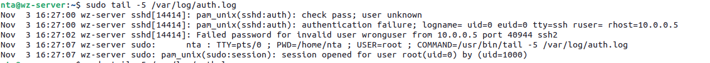
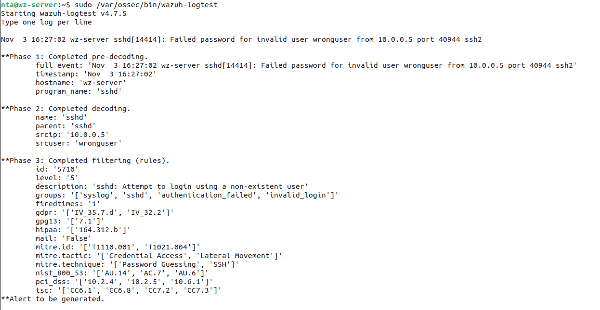
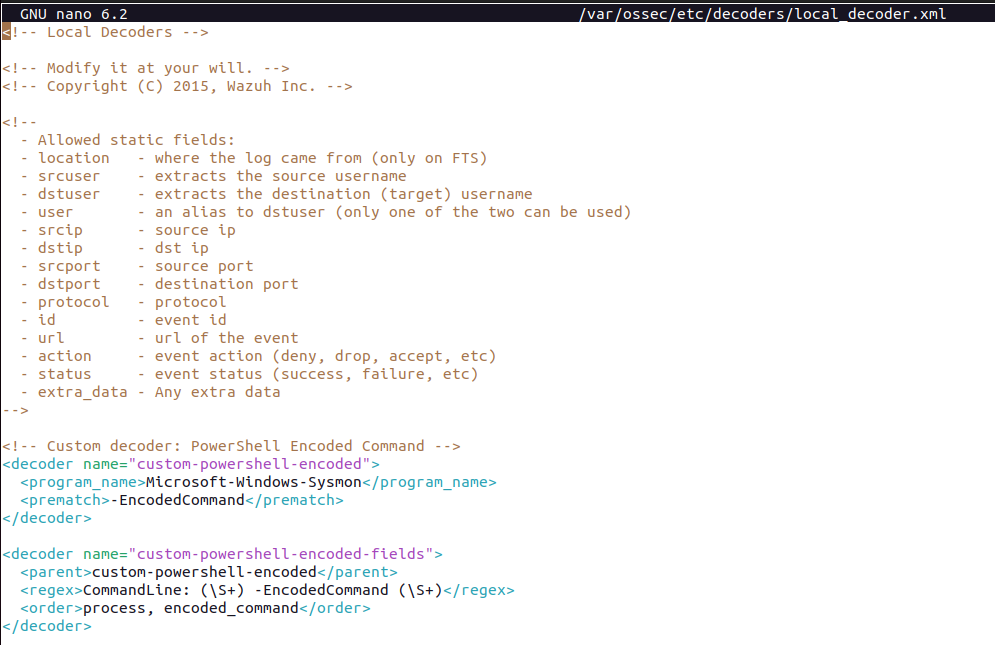

# Phase 3: Log parsing and custom decoders

## Overview

Review how Wazuh parses logs and check the built-in SSH decoder. Then write a custom decoder for PowerShell encoded commands and test it with `wazuh-logtest`.

## 3.1 Wazuh log parsing pipeline

Wazuh processes each incoming log in three phases:

```
Raw Log → Pre-decoding → Decoding → Rule Matching → Alert
```

| Phase             | Description                                                   |
| ----------------- | ------------------------------------------------------------- |
| **Pre-decoding**  | Extracts timestamp, hostname, program_name                    |
| **Decoding**      | Uses decoders (regex) to extract fields: srcip, user, port... |
| **Rule matching** | Compares decoded fields against rules to generate alerts      |

> Decoders extract fields from raw log text so rules can use them.

### Configuration files

| File                                        | Purpose                        |
| ------------------------------------------- | ------------------------------ |
| `/var/ossec/ruleset/decoders/`              | Built-in decoders (read-only)  |
| `/var/ossec/etc/decoders/local_decoder.xml` | Custom decoders (user-defined) |
| `/var/ossec/etc/rules/local_rules.xml`      | Custom rules                   |

## 3.2 Verify the built-in SSH decoder

Check for an existing decoder before writing one for a new log type.

```bash
# Search for SSH-related decoders
sudo grep -r "Failed password" /var/ossec/ruleset/decoders/
```



Wazuh has a built-in SSH decoder at `/var/ossec/ruleset/decoders/0310-ssh_decoders.xml`:

```xml
<decoder name="sshd">
  <program_name>^sshd</program_name>
</decoder>

<decoder name="sshd-failed">
  <parent>sshd</parent>
  <prematch>Failed password</prematch>
  <regex type="pcre2">Failed password for (?:invalid user |illegal user )?(\S+) from (\S+) port (\d+)</regex>
  <order>srcuser, srcip, srcport</order>
</decoder>
```

## 3.3 Test the built-in decoder with wazuh-logtest

### Step 1 - Generate a real SSH failed login

From Kali attacker:

```bash
ssh wronguser@10.0.0.6
# Enter wrong password when prompted
```

### Step 2 - Retrieve the real log

On Wazuh Server:

```bash
sudo tail -5 /var/log/auth.log
```


Sample output:

```
Nov  3 16:27:02 wz-server sshd[14414]: Failed password for invalid user wronguser from 10.0.0.5 port 40944 ssh2
```

### Step 3 - Test with wazuh-logtest

```bash
sudo /var/ossec/bin/wazuh-logtest
```

Paste the log line into the session. The expected output is:

```
**Phase 1: Completed pre-decoding.
	full event: 'Nov  3 16:27:02 wz-server sshd[14414]: Failed password for invalid user wronguser from 10.0.0.5 port 40944 ssh2'
	timestamp: 'Nov  3 16:27:02'
	hostname: 'wz-server'
	program_name: 'sshd'

**Phase 2: Completed decoding.
	name: 'sshd'
	parent: 'sshd'
	srcip: '10.0.0.5'
	srcuser: 'wronguser'

**Phase 3: Completed filtering (rules).
	id: '5710'
	level: '5'
	description: 'sshd: Attempt to login using a non-existent user'
	groups: '['syslog', 'sshd', 'authentication_failed', 'invalid_login']'
	firedtimes: '1'
	gdpr: '['IV_35.7.d', 'IV_32.2']'
	gpg13: '['7.1']'
	hipaa: '['164.312.b']'
	mail: 'False'
	mitre.id: '['T1110.001', 'T1021.004']'
	mitre.tactic: '['Credential Access', 'Lateral Movement']'
	mitre.technique: '['Password Guessing', 'SSH']'
	nist_800_53: '['AU.14', 'AC.7', 'AU.6']'
	pci_dss: '['10.2.4', '10.2.5', '10.6.1']'
	tsc: '['CC6.1', 'CC6.8', 'CC7.2', 'CC7.3']'
**Alert to be generated.

```



> The built-in SSH decoder extracts `srcip` and `srcuser`, so this SSH log needs no custom decoder.

## 3.4 Write a custom decoder for PowerShell encoded commands

Write a custom decoder to detect PowerShell encoded commands, which the built-in decoders do not cover.

### Target log (Sysmon Event ID 1)

```
CommandLine: powershell.exe -EncodedCommand VwByAGkAdABlAC0ATwB1AHQAcAB1AHQAIAAnAFcAYQB6AHUAaAAgAHQAZQBzAHQAJwA=
```

### Edit local_decoder.xml

```bash
sudo nano /var/ossec/etc/decoders/local_decoder.xml
```

Add these decoders before the closing tag:

```xml
<!-- Custom decoder: PowerShell Encoded Command -->
<decoder name="custom-powershell-encoded">
  <program_name>Microsoft-Windows-Sysmon</program_name>
  <prematch>-EncodedCommand</prematch>
</decoder>

<decoder name="custom-powershell-encoded-fields">
  <parent>custom-powershell-encoded</parent>
  <regex>CommandLine: (\S+) -EncodedCommand (\S+)</regex>
  <order>process, encoded_command</order>
</decoder>
```



### Apply changes

```bash
sudo systemctl restart wazuh-manager

# Verify no errors
sudo tail -20 /var/ossec/logs/ossec.log | grep -i error
```
