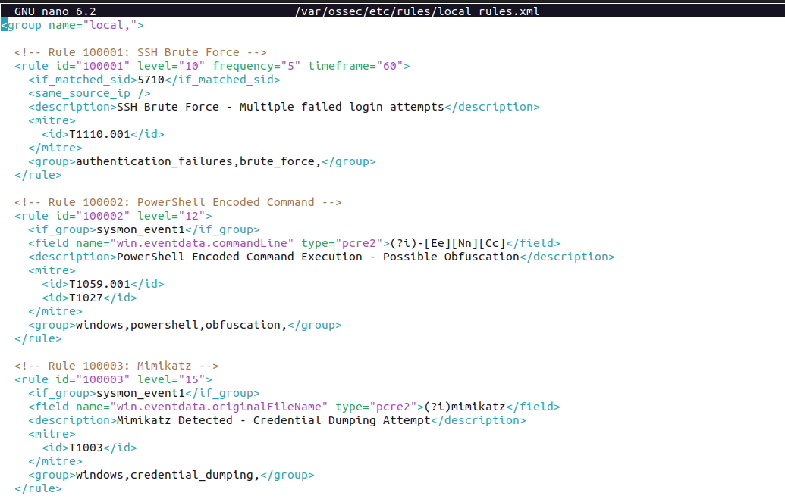
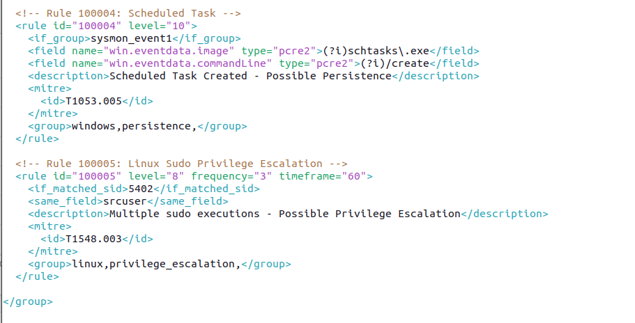
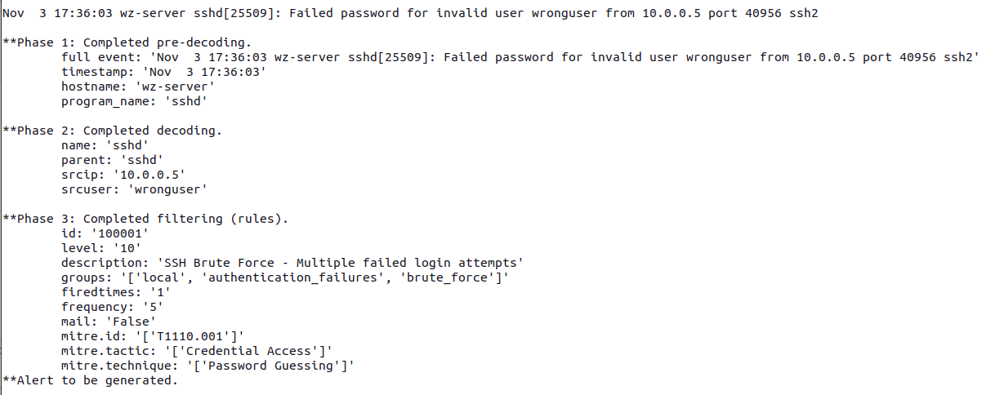

# Phase 4: Detection rules and MITRE mapping

## Overview

Write custom Wazuh detection rules and map them to MITRE ATT&CK techniques. Use `wazuh-logtest` to check the rules.

## 4.1 Wazuh rule syntax

Define custom rules in XML in `/var/ossec/etc/rules/local_rules.xml`.

```xml
<rule id="XXXXXX" level="X">
  <if_sid>PARENT_RULE_ID</if_sid>         <!-- trigger if parent rule fires -->
  <field name="FIELD">VALUE</field>        <!-- match on decoded field -->
  <description>Alert description</description>
  <mitre>
    <id>TXXXX</id>
  </mitre>
  <group>custom,groupname,</group>
</rule>
```

### Rule ID ranges

| Range           | Purpose                     |
| --------------- | --------------------------- |
| 1 - 99999       | Built-in Wazuh rules        |
| 100000 - 109999 | Custom rules (user-defined) |

### Rule levels

| Level   | Meaning                  |
| ------- | ------------------------ |
| 0 - 3   | Informational            |
| 4 - 7   | Low severity             |
| 8 - 11  | Medium severity          |
| 12 - 15 | High severity / Critical |

## 4.2 Rule: SSH brute force detection

This rule triggers after 5 or more failed SSH logins from the same source IP within 60 seconds.

```xml
<rule id="100001" level="10" frequency="5" timeframe="60">
  <if_matched_sid>5710</if_matched_sid>
  <same_source_ip />
  <description>SSH Brute Force - Multiple failed login attempts</description>
  <mitre>
    <id>T1110.001</id>
  </mitre>
  <group>authentication_failures,brute_force,</group>
</rule>
```

> `if_matched_sid: 5710`: the built-in SSH failed-login rule from Phase 3.
> `frequency: 5`: trigger after 5 matches.
> `timeframe: 60`: count matches within 60 seconds.
> `same_source_ip`: require the same source IP.

## 4.3 Rule: PowerShell encoded command

Detect PowerShell execution with an encoded command, an evasion technique.

```xml
<rule id="100002" level="12">
  <if_group>sysmon_event1</if_group>
  <field name="win.eventdata.commandLine" type="pcre2">(?i)-[Ee][Nn][Cc]</field>
  <description>PowerShell Encoded Command Execution - Possible Obfuscation</description>
  <mitre>
    <id>T1059.001</id>
    <id>T1027</id>
  </mitre>
  <group>windows,powershell,obfuscation,</group>
</rule>
```

## 4.4 Rule: Mimikatz / credential dumping

Use Sysmon events to detect known credential dumping tools.

```xml
<rule id="100003" level="15">
  <if_group>sysmon_event1</if_group>
  <field name="win.eventdata.originalFileName" type="pcre2">(?i)mimikatz</field>
  <description>Mimikatz Detected - Credential Dumping Attempt</description>
  <mitre>
    <id>T1003</id>
  </mitre>
  <group>windows,credential_dumping,</group>
</rule>
```

## 4.5 Rule: Suspicious scheduled task creation

Detect new scheduled tasks, which are commonly used for persistence.

```xml
<rule id="100004" level="10">
  <if_group>sysmon_event1</if_group>
  <field name="win.eventdata.image" type="pcre2">(?i)schtasks\.exe</field>
  <field name="win.eventdata.commandLine" type="pcre2">(?i)/create</field>
  <description>Scheduled Task Created - Possible Persistence</description>
  <mitre>
    <id>T1053.005</id>
  </mitre>
  <group>windows,persistence,</group>
</rule>
```

## 4.6 Rule: Linux privilege escalation via sudo

Detect repeated sudo commands from a non-standard user.

```xml
<rule id="100005" level="8" frequency="3" timeframe="60">
  <if_matched_sid>5402</if_matched_sid>
  <same_field>srcuser</same_field>
  <description>Multiple sudo executions - Possible Privilege Escalation</description>
  <mitre>
    <id>T1548.003</id>
  </mitre>
  <group>linux,privilege_escalation,</group>
</rule>
```

## 4.7 Apply rules

### Step 1 - Edit local_rules.xml

```bash
sudo nano /var/ossec/etc/rules/local_rules.xml
```

Add all rules inside the `<group name="local,">` tag:

```xml
<group name="local,">

  <!-- Rule 100001: SSH Brute Force -->
  <rule id="100001" level="10" frequency="5" timeframe="60">
    <if_matched_sid>5710</if_matched_sid>
    <same_source_ip />
    <description>SSH Brute Force - Multiple failed login attempts</description>
    <mitre>
      <id>T1110.001</id>
    </mitre>
    <group>authentication_failures,brute_force,</group>
  </rule>

  <!-- Rule 100002: PowerShell Encoded Command -->
  <rule id="100002" level="12">
    <if_group>sysmon_event1</if_group>
    <field name="win.eventdata.commandLine" type="pcre2">(?i)-[Ee][Nn][Cc]</field>
    <description>PowerShell Encoded Command Execution - Possible Obfuscation</description>
    <mitre>
      <id>T1059.001</id>
      <id>T1027</id>
    </mitre>
    <group>windows,powershell,obfuscation,</group>
  </rule>

  <!-- Rule 100003: Mimikatz -->
  <rule id="100003" level="15">
    <if_group>sysmon_event1</if_group>
    <field name="win.eventdata.originalFileName" type="pcre2">(?i)mimikatz</field>
    <description>Mimikatz Detected - Credential Dumping Attempt</description>
    <mitre>
      <id>T1003</id>
    </mitre>
    <group>windows,credential_dumping,</group>
  </rule>

  <!-- Rule 100004: Scheduled Task -->
  <rule id="100004" level="10">
    <if_group>sysmon_event1</if_group>
    <field name="win.eventdata.image" type="pcre2">(?i)schtasks\.exe</field>
    <field name="win.eventdata.commandLine" type="pcre2">(?i)/create</field>
    <description>Scheduled Task Created - Possible Persistence</description>
    <mitre>
      <id>T1053.005</id>
    </mitre>
    <group>windows,persistence,</group>
  </rule>

  <!-- Rule 100005: Linux Sudo Privilege Escalation -->
  <rule id="100005" level="8" frequency="3" timeframe="60">
    <if_matched_sid>5402</if_matched_sid>
    <same_field>srcuser</same_field>
    <description>Multiple sudo executions - Possible Privilege Escalation</description>
    <mitre>
      <id>T1548.003</id>
    </mitre>
    <group>linux,privilege_escalation,</group>
  </rule>

</group>
```




### Step 2 - Reload rules

```bash
sudo systemctl restart wazuh-manager
```

## 4.8 Test rules with wazuh-logtest

### Test rule 100001: SSH brute force

```bash
sudo /var/ossec/bin/wazuh-logtest
```

Paste this log 5+ times:

```
May  5 11:14:04 db-server sshd[110364]: Failed password for invalid user wronguser from 10.0.0.3 port 48080 ssh2
```

Expected: Rule `100001` fires after 5th attempt.



## 4.9 MITRE ATT&CK coverage Summary

| Rule ID | Description                   | MITRE Technique  | Tactic                     |
| ------- | ----------------------------- | ---------------- | -------------------------- |
| 100001  | SSH Brute Force               | T1110.001        | Credential Access          |
| 100002  | PowerShell Encoded Command    | T1059.001, T1027 | Execution, Defense Evasion |
| 100003  | Mimikatz / Credential Dumping | T1003            | Credential Access          |
| 100004  | Scheduled Task Persistence    | T1053.005        | Persistence                |
| 100005  | Linux Sudo Escalation         | T1548.003        | Privilege Escalation       |

> In Phase 5, built-in rules (5763, 92026, 92031, 5402) matched some attack patterns before the custom rules and generated the alerts.
