# Phase 5: Atomic Red Team simulation

## Overview

Install Atomic Red Team on the Windows and Linux endpoints. Run the MITRE ATT&CK simulations and check the resulting detections in Wazuh Dashboard.

## 5.1 Install Atomic Red Team on Windows

> Run on: Windows 10 - 10.0.0.7

### Step 1 - Set execution policy

```powershell
Set-ExecutionPolicy Bypass -Scope CurrentUser -Force
```

### Step 2 - Install Invoke-AtomicRedTeam module

```powershell
IEX (IWR 'https://raw.githubusercontent.com/redcanaryco/invoke-atomicredteam/master/install-atomicredteam.ps1' -UseBasicParsing)
Install-AtomicRedTeam -getAtomics
```

### Step 3 - Import module

```powershell
Import-Module "C:\AtomicRedTeam\invoke-atomicredteam\Invoke-AtomicRedTeam.psd1" -Force
```

### Step 4 - Verify

```powershell
Invoke-AtomicTest T1003 -ShowDetailsBrief
```

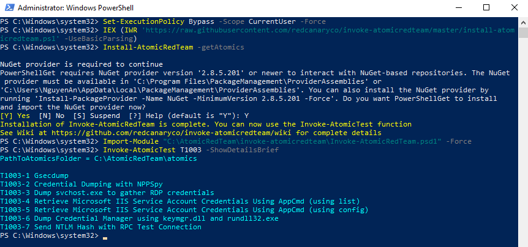

## 5.2 Install Atomic Red Team on Linux

> Run on: Ubuntu 20.04 - 10.0.0.4

### Step 1 - Install dependencies

```bash
sudo apt install ruby ruby-dev -y
```

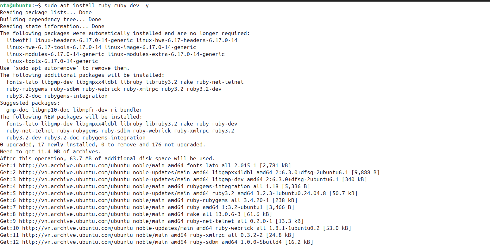

### Step 2 - Clone Atomic Red Team

```bash
git clone https://github.com/redcanaryco/atomic-red-team.git
```

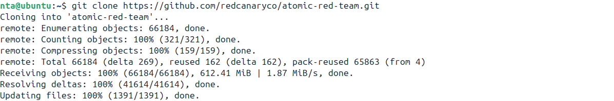

## 5.3 Attack simulations

### Simulation 1: T1110.001, password guessing (SSH brute force)

> Run on: Kali Linux

```bash
# Brute force SSH using hydra
hydra -l root -P /usr/share/wordlists/rockyou.txt ssh://10.0.0.4 -t 4 -V
```

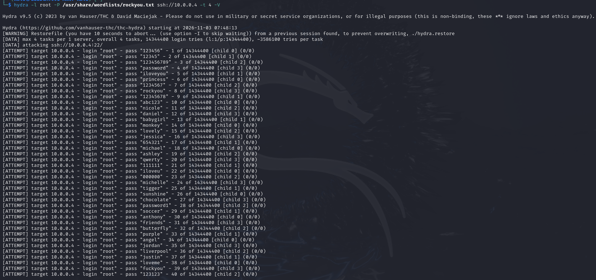

Wazuh detection:

- Decoder: `sshd`
- Rule: `5710` → `5763` (built-in brute force rule, level 10)
- MITRE: T1110.001 - Password Guessing

> Rule `5763` fires when Wazuh detects multiple failed SSH logins from the same source IP within a short timeframe.

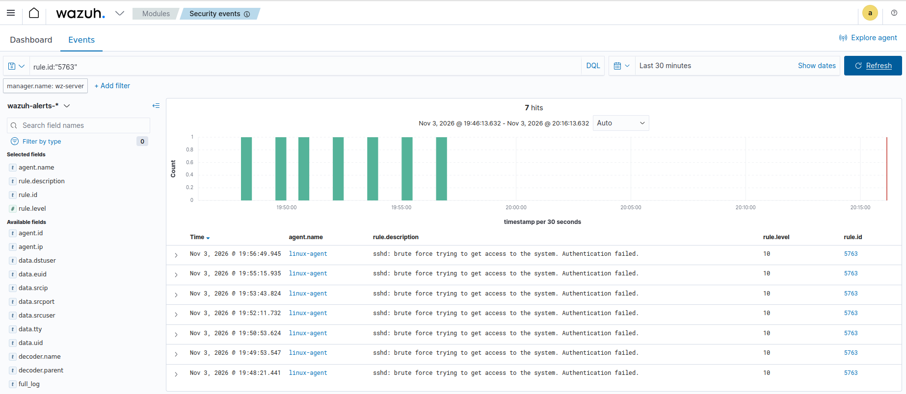
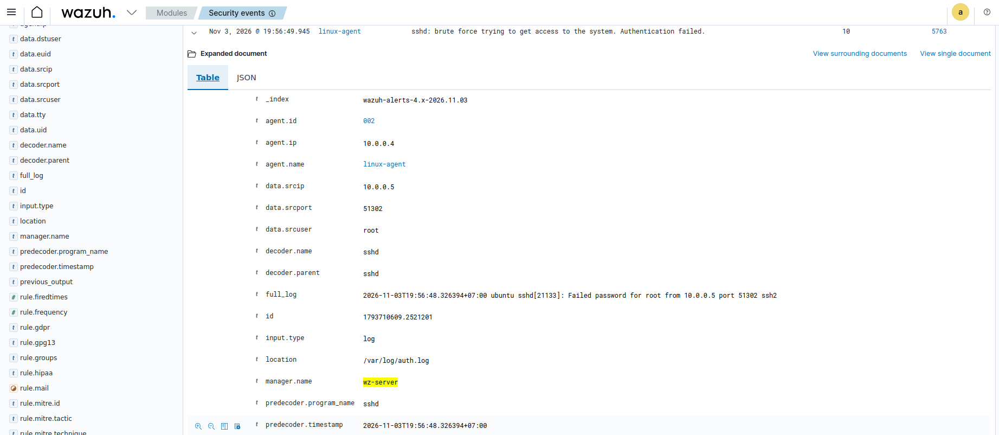
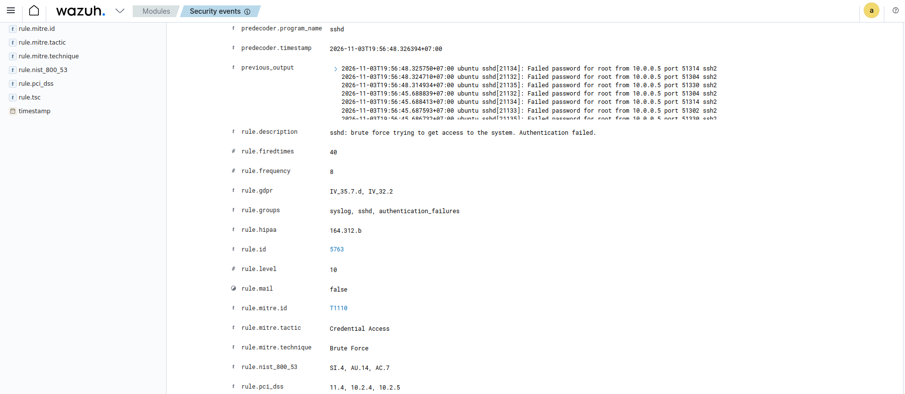

### Simulation 2: T1059.001, PowerShell execution

> Run on: Windows 10

```powershell
Invoke-AtomicTest T1059.001 -TestNumbers 17
```

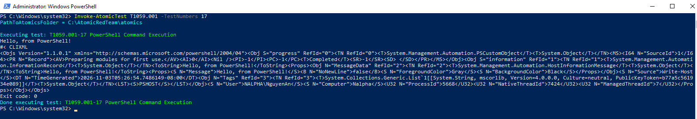

Wazuh detection:
- Rule 92057 - Powershell.exe spawned a powershell process which executed a base64 encoded command (Level 12)
- Rule 92213 - Executable file dropped in folder commonly used by malware (Level 15)
- MITRE: T1059.001 - PowerShell

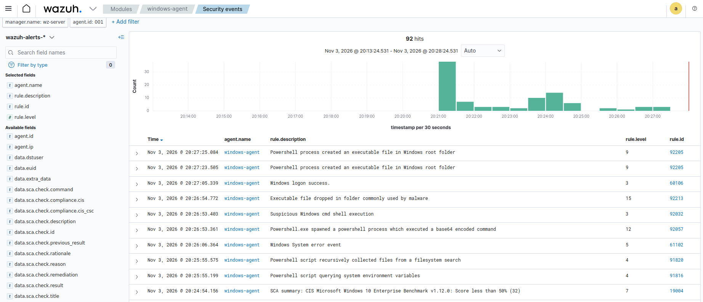

### Simulation 3: T1053.005, scheduled task persistence

> Run on: Windows 10

```powershell
Invoke-AtomicTest T1053.005 -TestNumbers 1
```

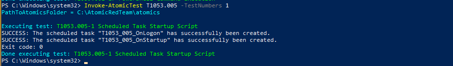

Wazuh detection:
- Expected alert: Rule `100004` - Scheduled Task Created (Level 10)
- MITRE: T1053.005 - Scheduled Task/Job

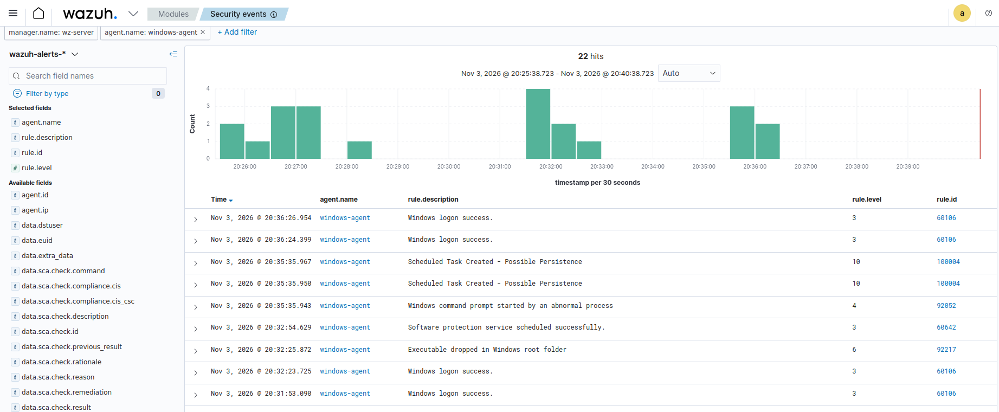

### Simulation 4: T1003, credential dumping

> Run on: Windows 10

```powershell
mkdir C:\temp
# Direct registry dump using reg.exe
reg save HKLM\SAM C:\temp\sam.hive /y
reg save HKLM\SYSTEM C:\temp\system.hive /y
```

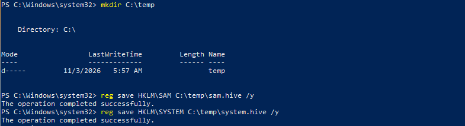

Wazuh detection:

- Rule 92026 - Reg.exe used to dump SAM hive (Level 14)
- MITRE: T1003 - OS Credential Dumping

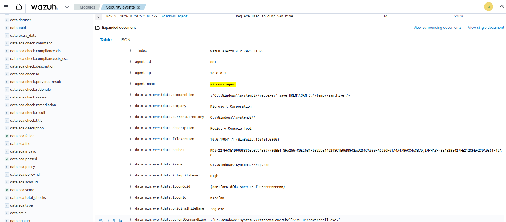

### Simulation 5: T1087, account discovery

> Run on: Windows 10

```powershell
for ($i=1; $i -le 5; $i++) { net user }
```

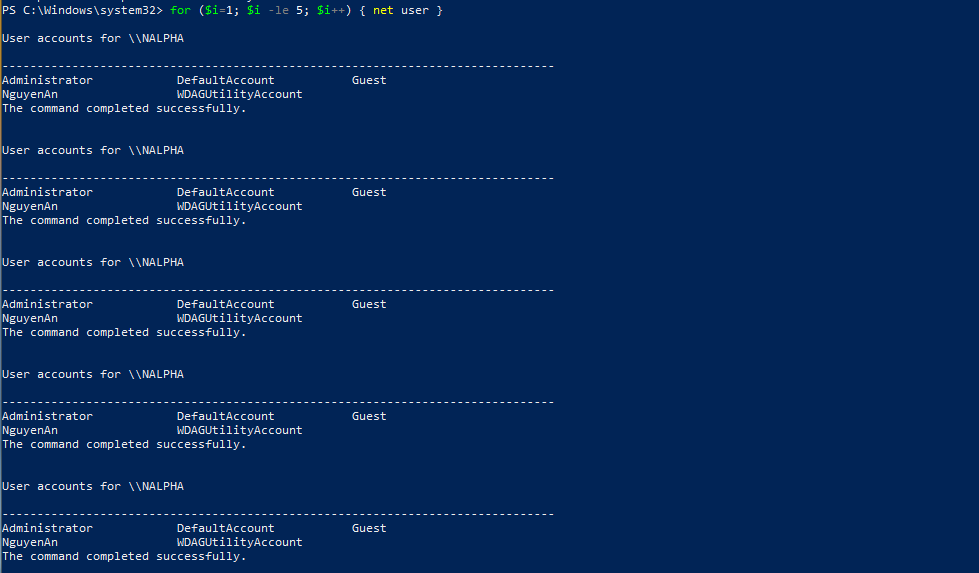

- Technique: T1087
- Method: Manual command execution
- Commands used:
  - net user
- Result:
  - Wazuh detected discovery activity
  - Rule IDs: 92031, 92033
  - Alert level: 3

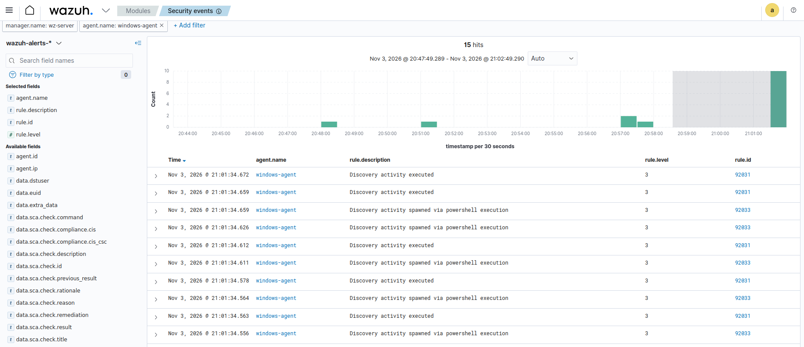

### Simulation 6: T1548.003, sudo privilege escalation

> Run on: Ubuntu 20.04

```bash
# Run multiple sudo commands rapidly
for i in {1..5}; do sudo whoami; done

# Check log Ubuntu
sudo grep -a 'sudo' /var/log/auth.log
```

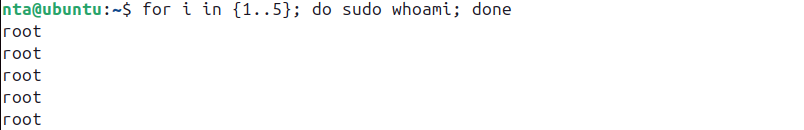
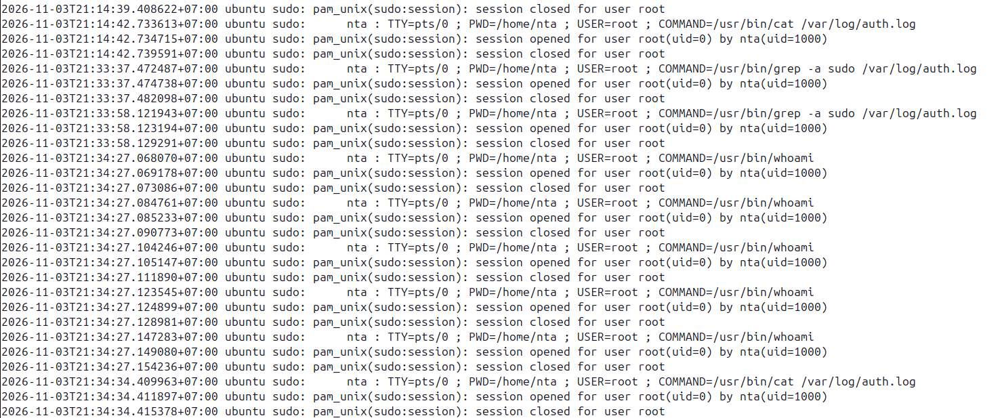

- Technique: T1548.003
- Commands:
  - sudo whoami (multiple times)
- Result:
  - Logs recorded in /var/log/auth.log
  - Wazuh detected successful privilege escalation
  - Alert: Successful sudo to ROOT executed

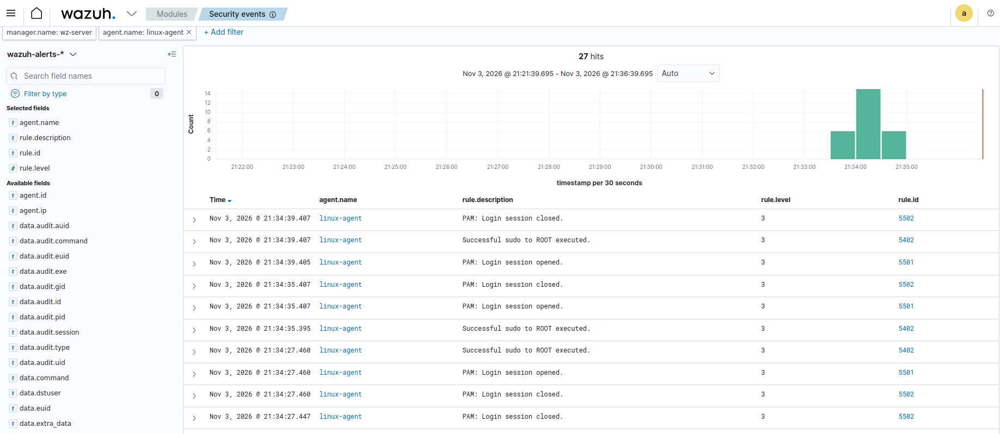
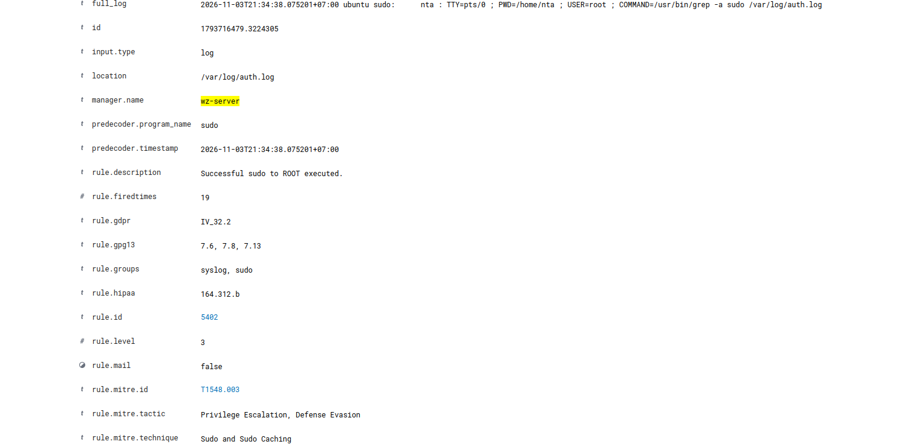

## 5.4 Cleanup after simulation

Remove the test artifacts after each simulation:

```powershell
# Windows - cleanup specific technique
Invoke-AtomicTest T1053.005 -TestNumbers 1 -Cleanup
Invoke-AtomicTest T1059.001 -TestNumbers 17 -Cleanup
```

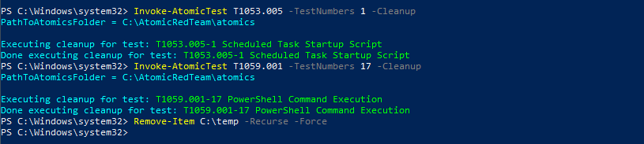

## 5.5 Verify detections on Dashboard

1. Open `https://10.0.0.6`
2. Navigate to **Security Events** → **MITRE ATT&CK**
3. Set the time range to cover the simulation
4. Check that the dashboard shows each technique

### Expected results

| Simulation           | MITRE Technique | Wazuh Rule | Level | Detected |
| -------------------- | --------------- | ---------- | ----- | -------- |
| SSH Brute Force      | T1110.001       | 5763       | 10    | ✅       |
| PowerShell Execution | T1059.001       | 92057      | 12    | ✅       |
| Scheduled Task       | T1053.005       | 100004     | 10    | ✅       |
| Credential Dumping   | T1003           | 92026      | 14    | ✅       |
| Account Discovery    | T1087           | 92031      | 3     | ✅       |
| Sudo Escalation      | T1548.003       | 5402       | 3     | ✅       |

## 5.6 Detection rate analysis

Total techniques simulated : 6
Total alerts generated : 6
Detection rate : 6/6 = 100%

## Phase 5 checklist

- [x] Atomic Red Team installed on Windows
- [x] Atomic Red Team cloned on Linux (bash execution)
- [x] T1110.001 - SSH Brute Force simulated and detected (Rule 5763, Level 10)
- [x] T1059.001 - PowerShell Execution simulated and detected (Rule 92057, Level 12)
- [x] T1053.005 - Scheduled Task simulated and detected (Rule 100004, Level 10)
- [x] T1003 - Credential Dumping simulated and detected (Rule 92026, Level 14)
- [x] T1087 - Account Discovery simulated and detected (Rule 92031, Level 3)
- [x] T1548.003 - Sudo Escalation simulated and detected (Rule 5402, Level 3)
- [x] All detections verified on Wazuh Dashboard
- [x] Cleanup completed on all agents
